<div align="center">

# 🏁 Velocity Rush

**A fast 3D arcade racer that runs in your browser.**
Story campaign · weapons & mystery boxes · jumps & flips · police chases · takedowns · online multiplayer · open world


### [▶ Play now in your browser](https://atharv96kog1.github.io/velocity-rush-game/)

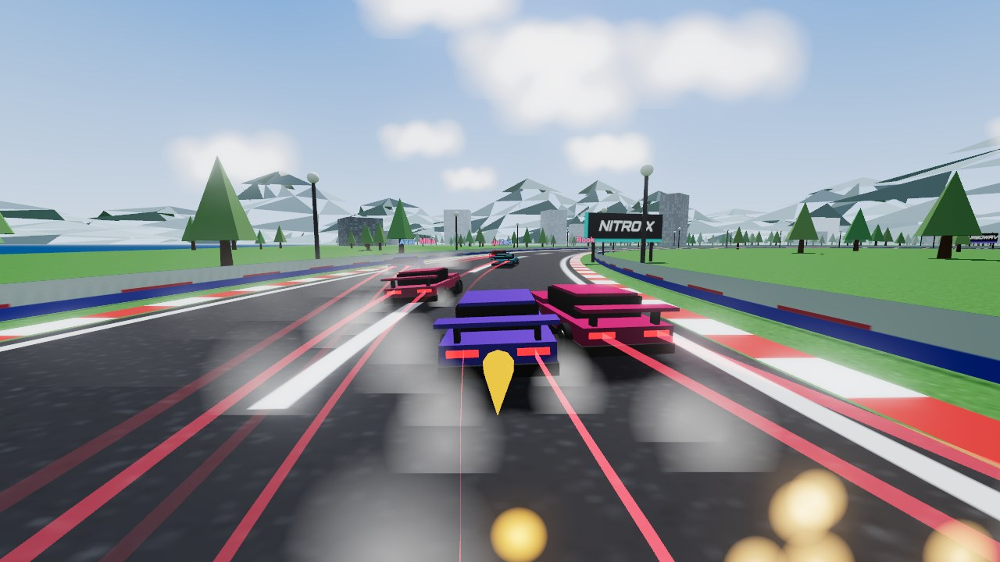

</div>

---

## Contents

- [Highlights](#highlights)
- [Screenshots](#screenshots)
- [Quick start](#quick-start)
- [Game modes](#game-modes)
- [Super powers](#super-powers)
- [Jumps, flips and mystery boxes](#jumps-flips-and-mystery-boxes)
- [Takedowns, stunts and police](#takedowns-stunts-and-police)
- [Style, weather and ghosts](#style-weather-and-ghosts)
- [Rewind, photo mode and soundtrack](#rewind-photo-mode-and-soundtrack)
- [Controls](#controls)
- [Online multiplayer](#online-multiplayer)
- [Architecture](#architecture)
- [Roadmap](#roadmap)

## Highlights

- **Runs anywhere, installs nothing.** Plain ES modules and Three.js from a CDN. No bundler, no `npm install`.
- **Tuned arcade handling.** 120 Hz fixed-step physics with grip, slip-angle limited drifting, nitro and slope gravity.
- **Eight modes.** Story campaign, quick race, knockout, challenges, open world, split-screen and online play.
- **1v1, 2v2, 3v3 and 6-car free-for-all**, with team scoring and AI teammates or rivals.
- **Jump and flip.** Press `F` to jump. In the air, flip, spin and barrel-roll with your own keys, and land wheels-down or crash.
- **Mystery boxes and weapons.** Rows of glowing **?** boxes hand out homing missiles, mines, oil slicks, bubble shields and rocket boosts to fire at rivals.
- **Takedowns.** Slam a rival into the wall and the game drops into a slow-motion crash cam while the wreck tumbles and scatters debris.
- **Police in races.** Cop cars with glowing lightbars and sirens hunt you down. They ram you, block your lane, and BUST you if you get pinned.
- **Ramps and stunts.** Every circuit has jumps. Hit them for BIG AIR, barrel rolls and flat spins.
- **Shockwave nitro.** Double-tap nitro for a huge burst with a sonic-boom ring and a camera kick.
- **Six unlockable super powers**, used by AI rivals too.
- **Style system.** Near misses, slipstreaming, overtakes and drift chains build a combo of up to x5 that refills nitro and pays credits.
- **Dynamic weather.** Clear, sunset, fog or rain. Rain brings a wet, reflective track, lower grip, spray and lightning.
- **Ghost racer.** Time trials save your best run, and next time you race against its replay.
- **Paint shop, achievements and daily challenges.** Ten paint colors per car, 12 achievements with rewards, and a new event every day.
- **Online multiplayer for up to 6 players** with room codes, over the internet (WebRTC) or a built-in LAN relay.
- **A 2 km × 2 km open world** with downtown, a coastal highway, ridge roads, lakes, traffic and collectibles.
- **Modern visuals.** Smooth sculpted car bodies with clear-coat paint reflecting the sky, bloom, light trails, sparks, shockwaves and a dynamic sky with clouds.
- **Cinematic post-processing.** Speed-reactive motion blur and chromatic aberration, a vignette, and camera shake on impacts.
- **Rewind.** Hold `Q` to roll the race back up to 8 seconds, 3 times per race.
- **Photo mode.** Freeze the action, orbit the camera, apply film looks and save a PNG.
- **Live soundtrack.** Synthwave music is generated in real time and intensifies with your speed and nitro.
- **Boost pads and car tuning.** Glowing pads on every circuit, plus engine, grip and nitro upgrades for each car.
- **Procedural audio.** Music, engine and UI sounds are all synthesized with WebAudio, so the game ships with no audio files.

## Screenshots

<table>
  <tr>
    <td width="50%">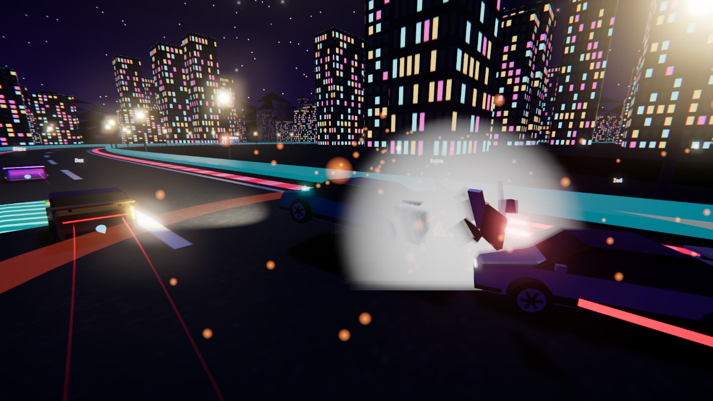<br><sub><b>Takedown</b>: slow-motion crash cam, debris and sparks</sub></td>
    <td width="50%">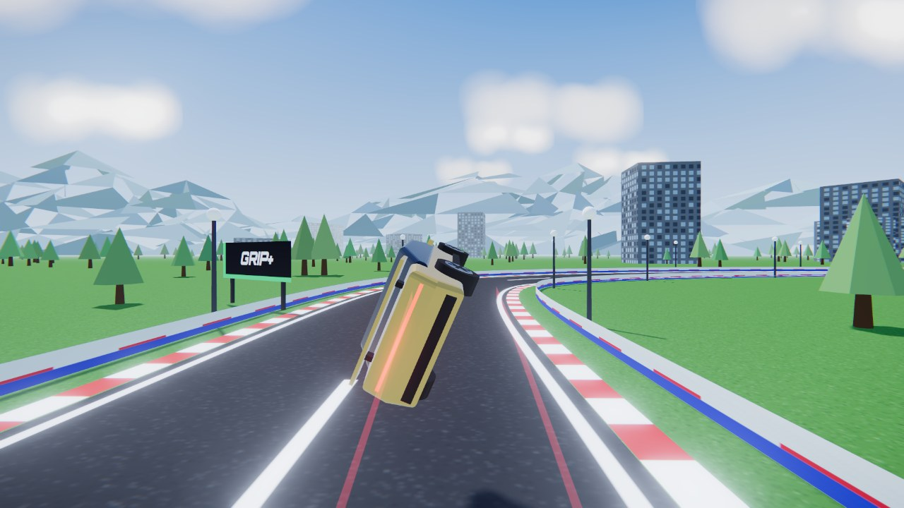<br><sub><b>Stunt ramp</b>: barrel roll mid-air</sub></td>
  </tr>
  <tr>
    <td colspan="2">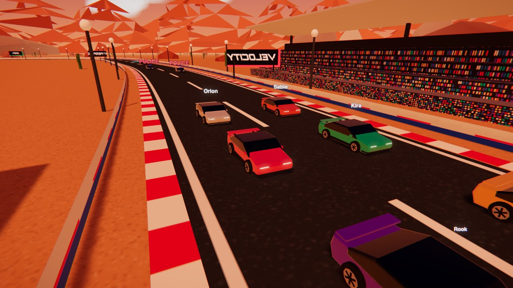<br><sub><b>Countdown flyby</b>: the camera sweeps over the grid before the start</sub></td>
  </tr>
  <tr>
    <td colspan="2">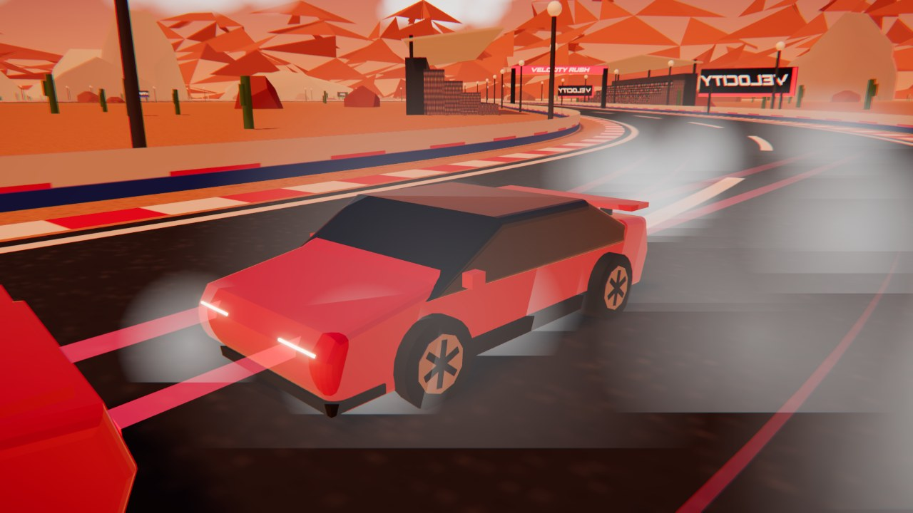<br><sub><b>Photo mode</b>: clear-coated car at sunset in Red Canyon</sub></td>
  </tr>
  <tr>
    <td width="50%">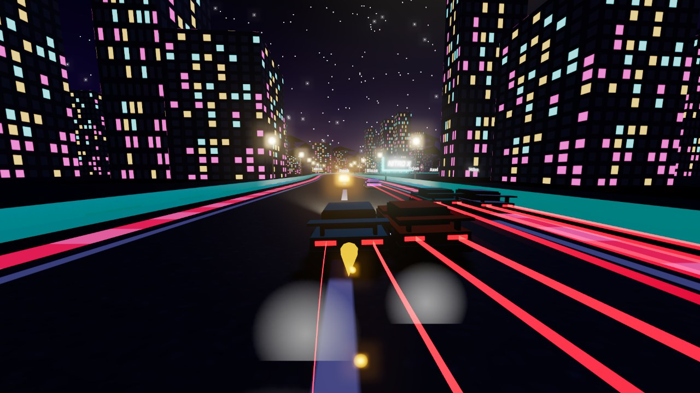<br><sub><b>Neon City</b>: midnight street circuit with Overdrive active</sub></td>
    <td width="50%">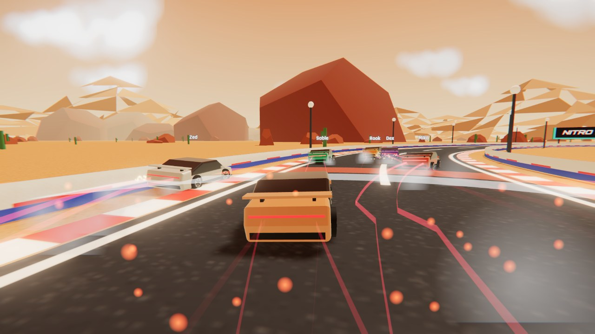<br><sub><b>Red Canyon</b>: a Shockwave scatters the pack</sub></td>
  </tr>
  <tr>
    <td width="50%">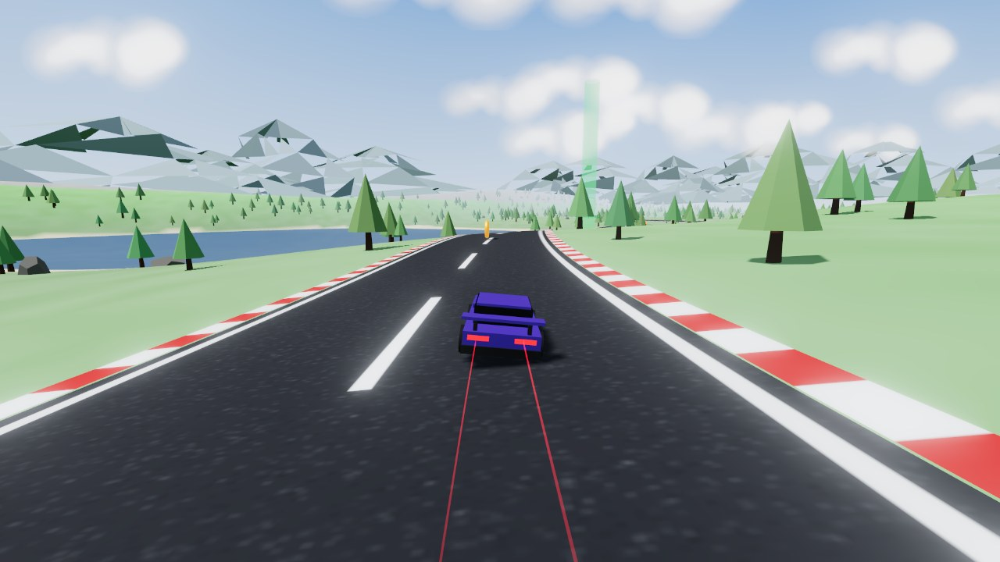<br><sub><b>Open World Tour</b>: coastal highway, lake and sprint beacon</sub></td>
    <td width="50%">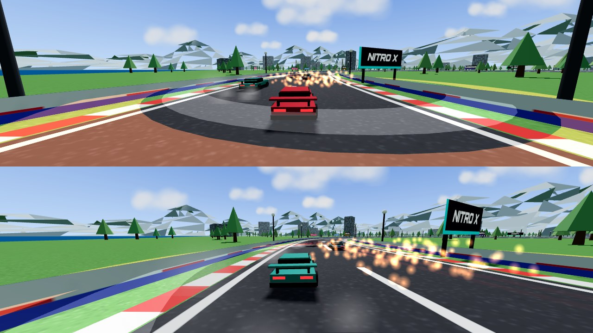<br><sub><b>Split-screen</b>: two players on one keyboard or two gamepads</sub></td>
  </tr>
  <tr>
    <td colspan="2">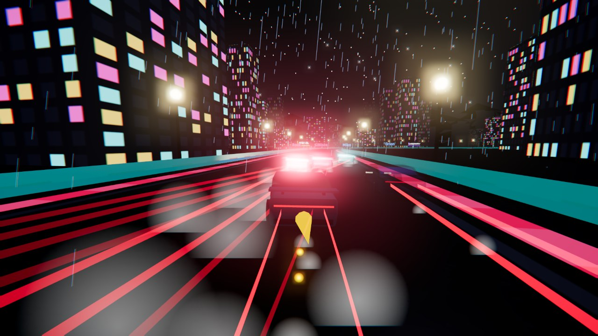<br><sub><b>Rain at night</b>: wet asphalt, light trails and lightning in Neon City</sub></td>
  </tr>
</table>

## Quick start

**Play online:** https://atharv96kog1.github.io/velocity-rush-game/. Nothing to install. Internet multiplayer works there too.

The current version is shown in the bottom-right corner of the main menu.

> [!NOTE]
> Mystery boxes, jumps and flips, police, ramps, roadblocks and takedowns work in every race mode, including **Online Multiplayer**. They aren't in the Open World yet.

**Run locally** (needed for local-network multiplayer). Requires Python 3 and a modern desktop browser (Chrome, Edge, Firefox or Safari).

```bash
git clone https://github.com/Atharv96KOG1/velocity-rush-game.git
cd velocity-rush-game
python3 serve.py
```

Open **http://localhost:8000**.

`serve.py` serves the game with caching disabled and hosts the LAN multiplayer relay. Three.js, PeerJS and the fonts load from CDNs, so you need an internet connection the first time.

> [!NOTE]
> Opening `index.html` directly from disk won't work: browsers block ES modules loaded from `file://`.

## Game modes

| Mode | Description |
|---|---|
| **Story Mode** | 8 chapters with characters and briefings: duel the local hotshot, team up in the canyon, take on the Neon Syndicate and its boss Vex, then win the Grand Prix. Each win unlocks the next chapter. |
| **Quick Race** | Any track, 1v1 / 2v2 / 3v3 / 6-car FFA, 1–5 laps, three AI difficulties, powers on or off. |
| **Knockout** | The last car is eliminated every lap until one remains. |
| **Local Multiplayer** | 2-player split-screen, as rivals or co-op teammates against AI. |
| **Online Multiplayer** | Up to 6 players with room codes, plus optional AI fill. |
| **Challenges** | Time trials, drift scoring, knockout and hard-AI races, with saved personal bests. |
| **Open World Tour** | Free roam with 45 coins, 6 speed traps, 4 checkpoint sprints and highway traffic. Solo or 2-player. |
| **Garage** | Four cars with distinct top speed, acceleration, handling and grip, bought with credits. Each one can be repainted and tuned: Engine, Tyres & Suspension and Nitro System, 3 levels each. |
| **Daily Challenge** | A new race, time trial, drift or knockout every day, generated from the date, with a 1,500 CR reward. |
| **Achievements** | 12 goals, from breaking 300 km/h to collecting every coin, each paying credits. |

**Roadblocks.** Every circuit has barrel stacks and concrete blocks in the lanes (14 on hard tracks, 5 on the others).
- **Barrel stacks:** smash straight through them, at the cost of speed. They come back 8 seconds later.
- **Concrete blocks:** you bounce off, and hit one above about 80 km/h and you're wrecked.
- **Jump them:** press `F` to clear either kind.
- AI drivers and cops swerve around them.

**Tracks:**
- Harbor Loop: day, fast sweepers
- Red Canyon: desert, tight hairpins
- Neon City: night street circuit
- **Skyline Gauntlet (hard):** 12 m wide night streets, four hairpins, 3 ramps, 14 roadblocks
- **Glacier Run (hard):** 13 m wide snowy pass with low grip, falling snow, 3 ramps, 14 roadblocks

Progress, including credits, cars, powers, story chapters, challenge bests and open-world collectibles, is saved in your browser's `localStorage`.

## Super powers

Unlock powers with credits on the **Super Powers** screen and equip one. The meter refills over time, twice as fast while drifting.

| | Power | Effect | Recharge |
|---|---|---|---|
| ⚡ | **Overdrive** | 3 s of massive thrust and +90 km/h top speed | 14 s |
| 💥 | **Shockwave** | Blasts every car within 24 m off its line | 16 s |
| 🛡️ | **Aegis Shield** | 5 s immune to hits and EMP; you bulldoze anyone you touch | 18 s |
| 👻 | **Phantom Phase** | 4 s passing through cars with full grip off-road | 16 s |
| 🌀 | **EMP Pulse** | Stalls every rival within 110 m for 2.5 s | 20 s |
| ✦ | **Blink** | Teleports 45 m ahead along the road | 22 s |

## Jumps, flips and mystery boxes

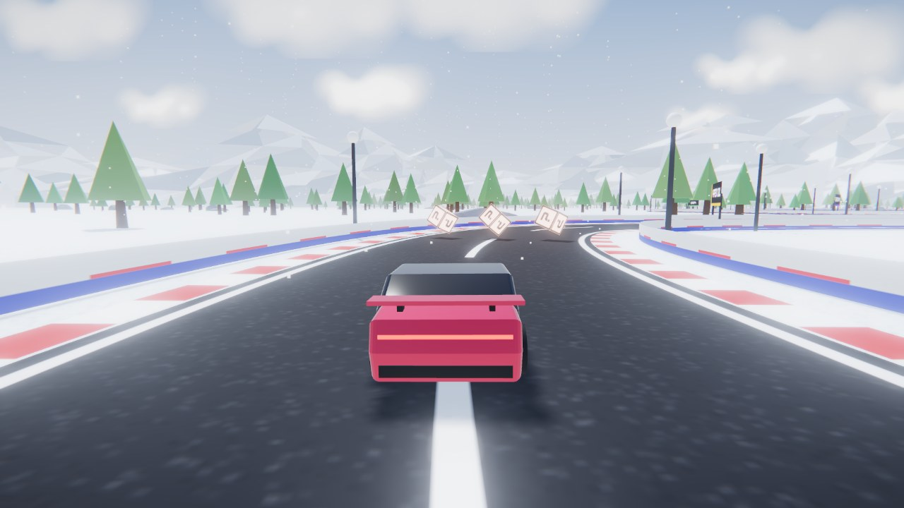

**Jump and air tricks.** Press `F` (P2: `;`, gamepad B) to hop about 2 metres up for roughly one second. Ramps send you higher. While airborne:

| Keys | Trick | Points |
|---|---|---|
| `W` / `S` | Front flip / backflip | 300 per rotation |
| `A` / `D` | 360 spin | 220 per rotation |
| `Space` + `A` / `D` | Barrel roll | 320 per rotation |

Mix them for DOUBLE and TRIPLE combos; two or more in one jump shouts **INSANE!** Every trick refills nitro.
- **Keys you're already holding when you take off don't count.** Holding the gas through a jump won't start an accidental flip.
- **Hands off = auto-level.** When you're not pressing a trick key, the car settles back to wheels-down on its own, so a plain jump always lands as a **PERFECT LANDING**.
- **Still rotating at touchdown** gives a **SLOPPY LANDING**: you lose speed and score nothing, but you keep racing.

**Finishing.** When you cross the line before the others, a **🏁 FINISHED** banner shows your place and the camera circles your car. Everyone still racing gets **30 seconds** to finish, with a countdown on screen; then the results appear.

**Knockout.** The last car is eliminated each time the leader completes a lap. If you're knocked out, a **💀 ELIMINATED** banner appears and the camera follows the race leader until the knockout ends.

**Respawn.** Crash and you're back on the road about 2.6 seconds later, upright, at 80 km/h. You blink and can't be hit for 2 seconds.

**Mystery boxes.** Four rows of three spinning **?** boxes sit on every circuit and come back 4 seconds after they're hit. Drive through one with an empty slot to get a random item, then press `X` (P2: `'`, gamepad Y) to use it. Leaders mostly get defensive items; cars at the back get weapons and speed.

| | Item | Effect |
|---|---|---|
| 🚀 | Homing Missile | Locks onto the car ahead, flies at 340 km/h and wrecks it |
| 💣 | Mine | Dropped behind you; any car that touches it explodes |
| 🛢️ | Oil Slick | Dropped behind you; cars that hit it spin out and lose half their speed |
| 🫧 | Bubble Shield | 6 seconds of protection; absorbs one missile, mine or oil slick |
| 🔥 | Rocket Boost | 2.6-second surge, stronger than nitro |

Rivals pick up and fire items too. Watch for **MISSILE INCOMING!**

## Takedowns, stunts and police

**Takedowns.** Hit a rival hard, or push them into a wall within 1.5 seconds of contact, and they're wrecked. Time slows to a quarter speed, the camera orbits the tumbling car, and debris and sparks fly. You score **TAKEDOWN** (+400) and a big nitro refill; wrecked cars respawn after a few seconds. Crash into a wall hard enough yourself and *you* get **WRECKED**.

**Police.** Turn on **Police** in Quick Race, or play story chapter 5 or the *Hot Pursuit* and *Wrecking Crew* challenges.
- Two cop cars (three on hard) start behind the grid. They're faster than any car in the garage.
- When you're ahead, they hunt you and ram you. When you're behind them, they slow down and block your lane.
- If a cop pins you below 25 km/h for about 2 seconds, you're **BUSTED** and held for 3 seconds.
- Taking down a cop scores **COP TAKEDOWN** (+600). Cops come back behind you a few seconds later.
- The siren gets louder as cops close in, and the minimap shows them as flashing red and blue dots.

**Ramps.** Each circuit has two jumps on its straights.
- Ramps give clean, level jumps. Cars never roll or spin by themselves; tricks are up to you.
- A cyan ramp gives a normal jump. A purple stunt ramp throws you higher, with time for a double flip.
- Land after a long jump for **BIG AIR**.
- Hard landings throw sparks and dust.

**Shockwave nitro.** Double-tap `Shift` with at least 40% nitro for a 1.8-second burst: +100 km/h top speed, purple flames, a sonic-boom ring and a camera kick. AI drivers use it too.

**Cinematics.** The camera sweeps over the grid during the countdown and settles behind your car at GO. Cars kick up dust off the tarmac.

## Style, weather and ghosts

**Style points.** Every trick tops up nitro, and your style total turns into bonus credits at the end of the race. Land the next trick within 3 seconds to raise the combo, up to x5.

| Trick | How |
|---|---|
| Slipstream | Tuck in 4–22 m behind a car at speed. While drafting you also get extra top speed. |
| Near miss | Pass alongside another car or traffic at speed without touching it |
| Overtake | Reach a new best position in the race |
| Drift | Hold a long drift; the bigger it is, the bigger the payout |

**Weather.** Pick it in Quick Race, the online lobby or the daily challenge. Some story chapters have fixed weather.

| | Weather | Effect |
|---|---|---|
| ☀️ | Clear | Standard conditions |
| 🌇 | Sunset | Low warm sun and purple sky |
| 🌫️ | Fog | Visibility drops to about 200 m |
| 🌧️ | Rain | Wet reflective asphalt, 18% less grip, tyre spray, lightning and thunder |

**Ghost racer.** In time trials and drift events your best run is recorded and saved. Next time, a see-through cyan car replays it, so you're always racing your personal best.

## Rewind, photo mode and soundtrack

**Rewind.** Missed a braking point? Hold `Q` (gamepad: Back) to run the race backwards at double speed, up to 8 seconds, with a blue rewind look. You get 3 rewinds per race. It works in every offline mode except knockout.

**Photo mode.** Press `P` or choose it from the pause menu. The race freezes, the HUD hides, and you can:
- drag to orbit the car and scroll to zoom
- pick a look: Natural, Noir, Vivid or Retro
- click **Save Photo** to download a PNG

**Boost pads.** Every circuit has four glowing chevron pads on its straights. Drive over one for a 1-second surge of thrust; AI drivers use them too.

**Soundtrack.** A synthwave track in A minor (Am–F–C–G, 112 BPM) is synthesized live. The menu plays pads and bass; races add drums and an echoing arpeggio; the filter opens up as you go faster. Press `M` to mute.

## Controls

| Action | Player 1 / Solo | Player 2 | Gamepad |
|---|---|---|---|
| Accelerate | `W` (solo: `↑` too) | `↑` | RT |
| Brake / reverse | `S` | `↓` | LT |
| Steer | `A` `D` | `←` `→` | Left stick |
| Handbrake / drift | `Space` | `/` or `Right Ctrl` | A |
| Nitro (double-tap: shockwave) | `Left Shift` | `Right Shift` | X |
| Jump | `F` | `;` | B |
| Air tricks | `W`/`S` flip · `A`/`D` spin · `Space`+`A`/`D` roll | arrows · `/`+arrows | stick |
| Use item | `X` | `'` | Y |
| Super power | `E` | `Enter` | LB |
| Reset to road | `R` | `Backspace` | Start |
| Camera (chase / far / hood) | `C` | `.` | RB |
| Rewind (hold) | `Q` | | Back |
| Photo mode | `P` | | |
| Music on / off | `M` | | |
| Pause | `Esc` | | |

Drifting fills the nitro bar. Driving off the tarmac costs speed.

## Online multiplayer

Open **Online Multiplayer**, enter a name, and pick a connection type:

| Option | When to use | How friends join |
|---|---|---|
| **Host Online Room** | Players in different places | They open the game anywhere and enter the 5-letter code. If a direct connection is blocked, the game switches to the cloud relay automatically. |
| **Host on Local Network** | Same Wi-Fi, or networks that block peer-to-peer | They open `http://<host-ip>:8000` (printed by `serve.py`) and enter the code |

When joining, the game tries the local relay first and then the internet. The host picks the track, mode, format, laps, AI fill and difficulty in the lobby, and everyone returns there after each race.

**How it works**

- **Star topology.** Clients connect to the host, and the host relays messages to everyone else.
- **Local authority.** Each browser simulates its own car and broadcasts its state 20 times a second. Remote cars are smoothed and extrapolated between updates.
- **Host authority.** The host simulates the AI and the police, runs knockout eliminations and decides when the race ends, so every player sees the same results.
- **Ownership.** Each browser decides pickups, item hits, landings and crashes for the cars it owns, then broadcasts the result. Everyone sees the same mystery boxes, missiles, mines, wrecks and stunts.
- **Lobby toggles.** The host can turn mystery boxes and police on or off.
- **Slow motion** is local-only, so it's turned off online.
- **Powers as events.** When a power fires, every browser plays the effect and applies it to the cars it owns.
- **Transports.** Internet rooms first try WebRTC data channels through [PeerJS](https://peerjs.com/) (direct, lowest latency). If a strict router, mobile hotspot or office network blocks that, the joiner falls back to a cloud relay: public MQTT brokers over secure WebSockets (EMQX, HiveMQ, Mosquitto). LAN rooms use the WebSocket relay in `serve.py`. Game traffic on the public relay is not encrypted end to end, so don't put personal information in player names.

> [!TIP]
> If joining still fails, the joiner's network is likely blocking the relay ports too (8084, 8884 and 8081). Try a different network, such as a phone hotspot, or play on the same Wi-Fi with a LAN room.

## Architecture

```
velocity-rush/
├── index.html            Entry page and import map
├── style.css             Menus, HUD and overlays
├── serve.py              No-cache static server + LAN WebSocket relay
├── stamp.py              Stamps a content-hash version on every module URL (run before each commit)
├── docs/screenshots/     README images
└── src/
    ├── main.js           Bootstrap
    ├── game.js           Renderer, bloom pipeline, 120 Hz fixed-step loop, split-screen viewports
    ├── car.js            Car mesh and arcade vehicle physics
    ├── track.js          Spline roads: sampling, nearest-point queries, road / kerb / wall meshes
    ├── ai.js             Look-ahead steering with bend-aware braking
    ├── powers.js         Super power definitions, charging, activation, AI usage
    ├── style.js          Style points: slipstream, near misses, overtakes, drift combos
    ├── weather.js        Weather themes, fog ranges, rain particles and lightning
    ├── ghost.js          Ghost run recording and playback
    ├── achieve.js        Achievement unlocks and toast notifications
    ├── action.js         Jumps and air tricks, takedowns and crash cam, police, ramps, shockwave nitro, countdown flyby, dust
    ├── items.js          Mystery boxes, missiles, mines, oil slicks, shields and rocket boosts
    ├── rewind.js         Snapshot ring buffer for rewinding races
    ├── photo.js          Photo mode orbit camera and PNG export
    ├── music.js          Procedural synthwave soundtrack
    ├── post.js           Speed blur, chromatic aberration, vignette and film looks
    ├── fx.js             Sparks, shockwave rings, shield shader, light trails
    ├── session-race.js   Circuit races: grid, laps, ranking, teams, knockout, goals, network sync
    ├── session-world.js  Open world: terrain, road network, collisions, events, traffic
    ├── session-menu.js   Showroom scene behind the menus
    ├── net.js            Rooms over PeerJS (internet) or the WebSocket relay (LAN)
    ├── env.js            Sky, clouds, mountains, lighting, scenery, grandstands, billboards
    ├── hud.js            HUD overlay and minimap
    ├── ui.js             Menus, story, garage, powers, lobby, pause and results screens
    ├── input.js          Keyboard and gamepad mapping
    ├── audio.js          Synthesized engine and UI sounds
    ├── save.js           localStorage persistence
    └── data.js           Cars, tracks, story chapters, challenges
```

**Design notes**

- **Sessions.** Each mode is a session object with `update(dt)` (physics), `frame(dt)` (presentation) and a list of views. The game loop runs any of them, including split-screen through scissored viewports.
- **Tracks.** Every track is a centripetal Catmull-Rom spline sampled every ~2 m. The same samples drive the road meshes, wall collisions, lap counting, AI racing lines and the minimap.
- **Open-world queries.** A spatial hash over road samples, trees and buildings keeps "which road am I on" and collision checks cheap.
- **Car physics.** Velocity is split into forward and lateral parts in the car's frame. Grip bleeds off lateral speed, the handbrake lowers grip to start a drift, and the slip angle is capped so drifts stay controllable.

## Roadmap

- [ ] Online sessions in the open world
- [ ] More tracks and an in-game track editor
- [ ] glTF car models and recorded engine audio
- [ ] Touch controls for tablets

---

<div align="center">
<sub>Built with <a href="https://threejs.org/">Three.js</a> and <a href="https://peerjs.com/">PeerJS</a>.</sub>
</div>
